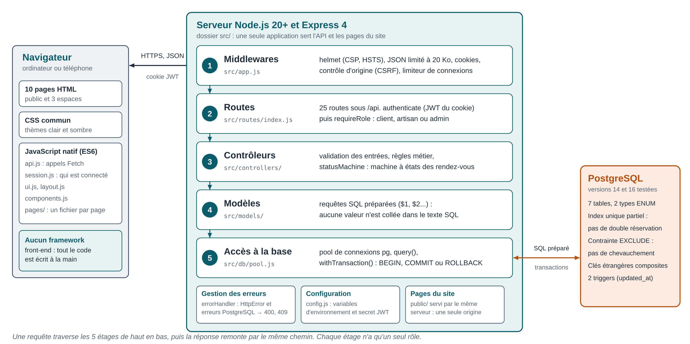
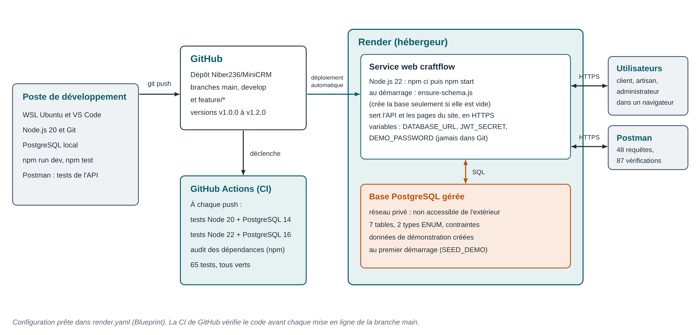
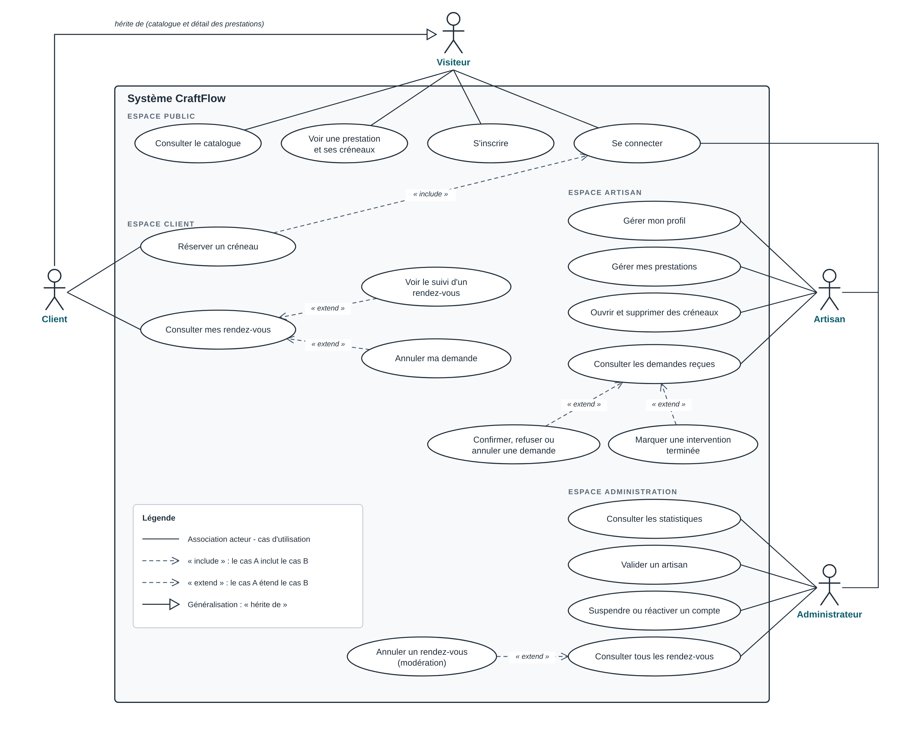
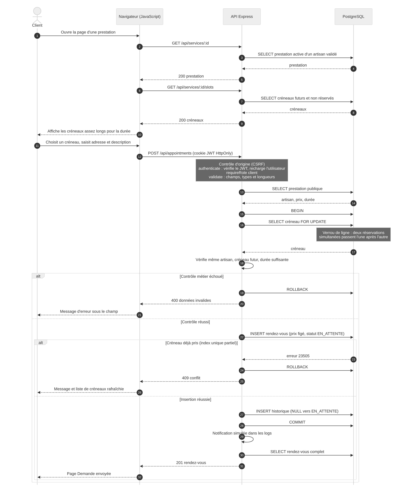
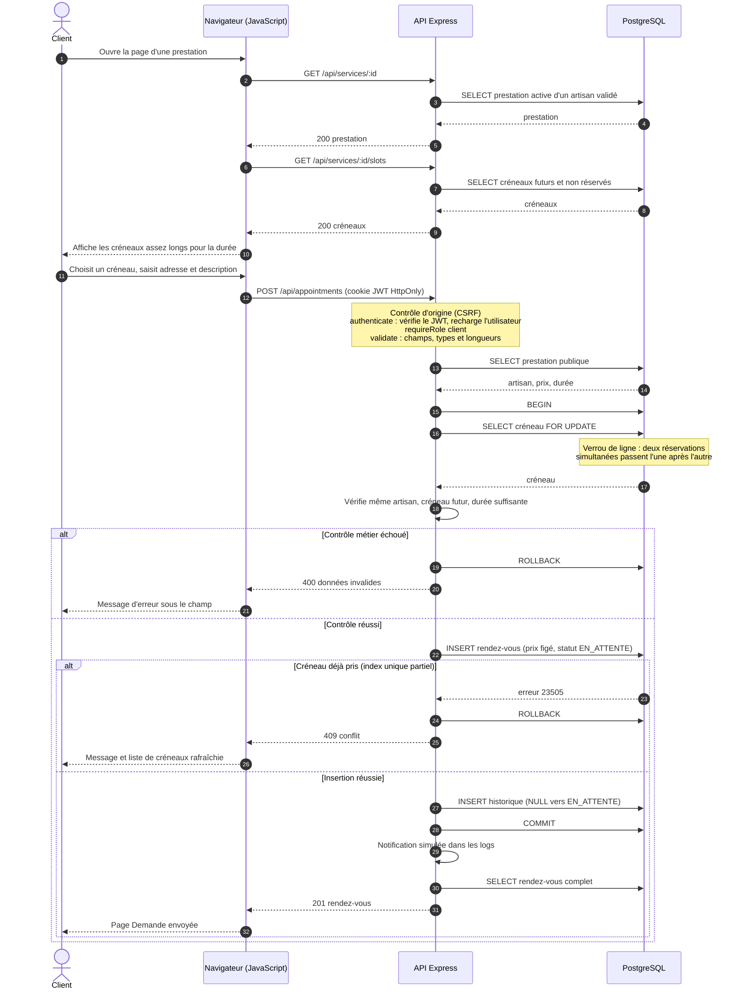
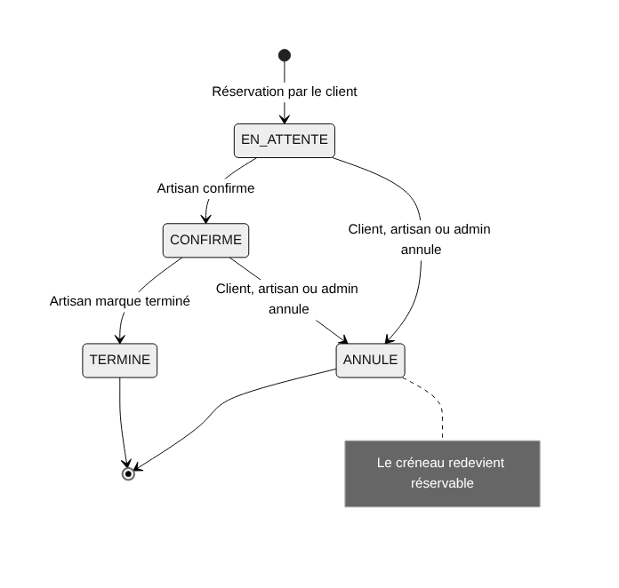
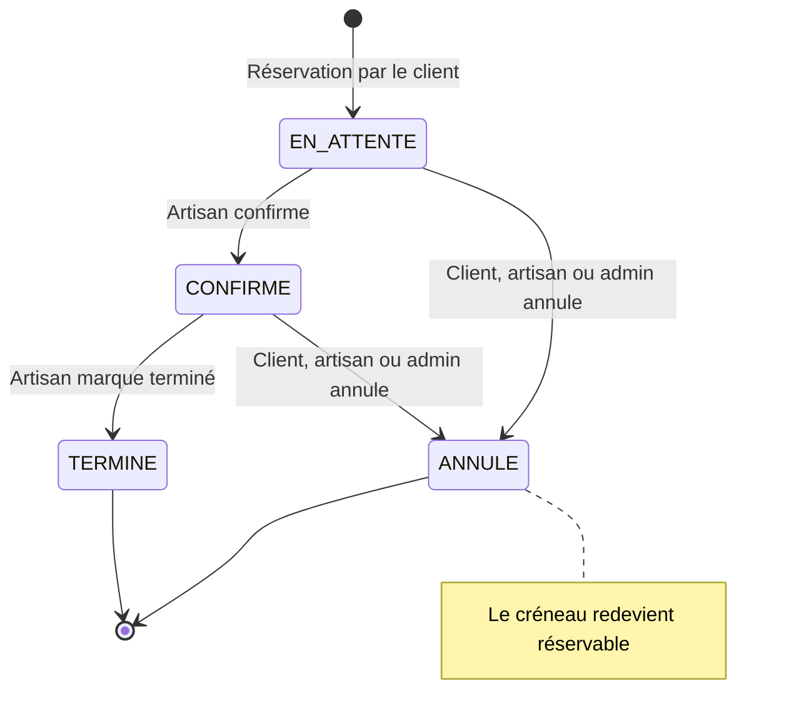

# CraftFlow : diagrammes d'architecture

Cinq diagrammes décrivent le système : son architecture, son déploiement et son comportement. Les images (dossier `diagrams/`) sont prêtes à coller
dans un document Word ou PDF. Les diagrammes de séquence et d'états sont aussi fournis en texte Mermaid,
que GitHub affiche directement et que l'on peut modifier.

## 1. Architecture logique : du navigateur à la base de données

Une requête traverse **cinq étages**, de haut en bas, puis la réponse remonte par le même chemin. Chaque étage a un seul rôle.

| Étage | Fichier | Rôle |
|---|---|---|
| 1. Middlewares | `src/app.js` | En-têtes de sécurité (Helmet : CSP, HSTS), JSON limité à 20 Ko, lecture des cookies, contrôle de l'origine (CSRF), limitation des tentatives de connexion |
| 2. Routes | `src/routes/index.js` | Les 25 routes de l'API. `authenticate` vérifie le JWT du cookie, puis `requireRole` contrôle le rôle (client, artisan, admin) |
| 3. Contrôleurs | `src/controllers/` | Validation des entrées, règles métier, `statusMachine` pour les statuts des rendez-vous |
| 4. Modèles | `src/models/` | Les requêtes SQL, toutes préparées (`$1`, `$2`) : aucune valeur n'est collée dans le texte SQL |
| 5. Accès à la base | `src/db/pool.js` | Pool de connexions, `query()` et `withTransaction()` (BEGIN, COMMIT, ROLLBACK) |

En plus : `errorHandler` traduit les erreurs (HttpError, erreurs PostgreSQL) en codes HTTP lisibles ; `config.js` lit les variables d'environnement et refuse un `JWT_SECRET` trop court en production ; le dossier `public/` est servi par le **même serveur** que l'API.

Points à retenir :

- **Séparation des responsabilités** : changer la base touche les modèles, changer une règle métier touche les contrôleurs, changer une route touche les routes. Chaque couche se teste séparément.
- **Une seule origine** : le même serveur envoie les pages et répond à l'API. Les cookies de session stricts (`SameSite=Strict`) fonctionnent donc sans configuration CORS.
- **Aucun framework front-end** : le navigateur reçoit 10 pages HTML, un CSS commun et du JavaScript natif en modules (`api.js`, `session.js`, `ui.js`, `layout.js`, `components.js`, un fichier par page).
- **L'ordre des middlewares compte** : la sécurité (en-têtes, taille du JSON, origine) passe avant les routes, donc avant tout traitement métier.

## 2. Architecture de déploiement et d'outils

Le code est écrit sur le poste de développement (WSL, VS Code, Git, PostgreSQL local, Postman), puis envoyé sur GitHub avec `git push`. À chaque push, **GitHub Actions** lance les tests sur deux combinaisons (Node 20 avec PostgreSQL 14, Node 22 avec PostgreSQL 16) et un audit des dépendances.

Le fichier `render.yaml` décrit l'hébergement sur **Render** : un service web Node.js et une base PostgreSQL sur réseau privé. Au démarrage, `db/ensure-schema.js` crée le schéma **seulement si la base est vide** (jamais d'effacement d'une base qui contient des données). Les secrets (`JWT_SECRET`, `DEMO_PASSWORD`) sont des variables d'environnement, jamais écrites dans Git. Détail pas à pas : [deploiement.md](deploiement.md).

État : la configuration de déploiement est prête et testée en simulation ; la mise en ligne dépend du compte Render de l'auteur.

## 3. Diagramme de cas d'utilisation

| Acteur | Rôle | Ce qu'il peut faire |
|---|---|---|
| **Visiteur** | Personne non connectée | Consulter le catalogue, voir une prestation et ses créneaux, s'inscrire, se connecter |
| **Client** | Particulier connecté | Tout ce que fait le visiteur pour la consultation, puis réserver un créneau, suivre et annuler ses rendez-vous |
| **Artisan** | Professionnel connecté | Gérer son profil, ses prestations et ses créneaux, traiter les demandes reçues (confirmer, refuser, terminer, annuler) |
| **Administrateur** | Modérateur de la plateforme | Consulter les statistiques, valider les artisans, suspendre des comptes, modérer les rendez-vous |

Points à retenir :

- **« Réserver un créneau » inclut « Se connecter »** : la réservation exige une session. Un visiteur est redirigé vers la
  connexion, puis revient sur la page de la prestation.
- **Un client est un visiteur connecté** : il hérite de la consultation du catalogue (généralisation).
- **Les cas « extend » sont des actions optionnelles** faites depuis une liste : le suivi et l'annulation depuis « Mes rendez-vous »,
  la confirmation et la clôture depuis les demandes reçues, l'annulation de modération depuis tous les rendez-vous.
- **Il n'existe aucun cas d'utilisation « devenir administrateur »** : ce compte est créé uniquement par un script serveur
  (`npm run create-admin`), jamais depuis le site. L'API refuse `role: admin` à l'inscription.

## 4. Diagramme de séquence : réservation d'un créneau

Ce que le diagramme démontre :

- **Rien n'est cru sans vérification côté serveur.** Le contrôle d'origine (CSRF), l'authentification (JWT du cookie `HttpOnly`,
  utilisateur rechargé en base), le rôle et la validation des champs passent avant toute écriture.
- **La réservation est une transaction** (`BEGIN` ... `COMMIT`) : le rendez-vous et la première ligne d'historique sont créés
  ensemble ou pas du tout.
- **Deux protections contre la double réservation**, l'une complétant l'autre :
  1. `SELECT ... FOR UPDATE` verrouille la ligne du créneau : deux demandes simultanées s'exécutent l'une après l'autre ;
  2. l'index unique partiel `appointments_one_active_per_slot` refuse un second rendez-vous non annulé sur le même créneau.
  La seconde personne reçoit `409`, et l'interface rafraîchit la liste des créneaux.
- **Le prix est figé** : `price_cents` est copié dans le rendez-vous au moment de la réservation.
- **Le rôle des codes HTTP** : `400` données invalides, `401` non connecté, `403` mauvais rôle, `404` introuvable, `409` créneau pris,
  `422` transition de statut interdite.

## 5. Diagramme d'états : cycle de vie d'un rendez-vous

| Depuis | Vers | Qui peut le faire |
|---|---|---|
| `EN_ATTENTE` | `CONFIRME` | Artisan |
| `EN_ATTENTE` | `ANNULE` | Client, artisan, administrateur |
| `CONFIRME` | `TERMINE` | Artisan |
| `CONFIRME` | `ANNULE` | Client, artisan, administrateur |
| `TERMINE`, `ANNULE` | aucune | États finaux |

Toute autre demande est refusée avec le code `422`. La logique est dans `src/services/statusMachine.js`, et chaque
changement est enregistré dans `appointment_status_history` (qui, quand, de quel statut vers quel statut).

Le type `appointment_status` est un ENUM PostgreSQL : même un script qui écrirait directement en base ne pourrait pas
inventer un cinquième statut.

## Questions probables du jury

**Pourquoi un client n'a-t-il pas de cas « s'inscrire » ?** Parce que l'inscription est faite par le visiteur, qui devient ensuite client.

**Que se passe-t-il si deux clients cliquent en même temps sur le même créneau ?** Le premier verrouille la ligne et réussit.
Le second attend le verrou, puis l'index unique le refuse : il reçoit `409`, sans aucune donnée corrompue.

**Pourquoi vérifier le rôle dans l'API alors que l'interface cache déjà les boutons ?** L'interface n'est qu'un confort :
n'importe qui peut appeler l'API directement. La vraie protection est le middleware `requireRole`.

**Pourquoi découper le serveur en couches (routes, contrôleurs, modèles) ?** Pour que chaque fichier n'ait qu'un rôle : on modifie une règle métier sans toucher au SQL, et on teste chaque couche séparément.

**Pourquoi aucun framework front-end ?** Pour maîtriser directement le DOM et les échanges HTTP, éviter l'étape de compilation, et pouvoir interdire tout script ou style en ligne côté serveur (politique CSP stricte), ce qui limite les failles XSS.

**Que se passe-t-il quand vous faites `git push` ?** GitHub Actions lance les tests sur Node 20 + PostgreSQL 14 et Node 22 + PostgreSQL 16, plus un audit des dépendances. Une fois la branche `main` à jour, Render peut redéployer le site automatiquement.
