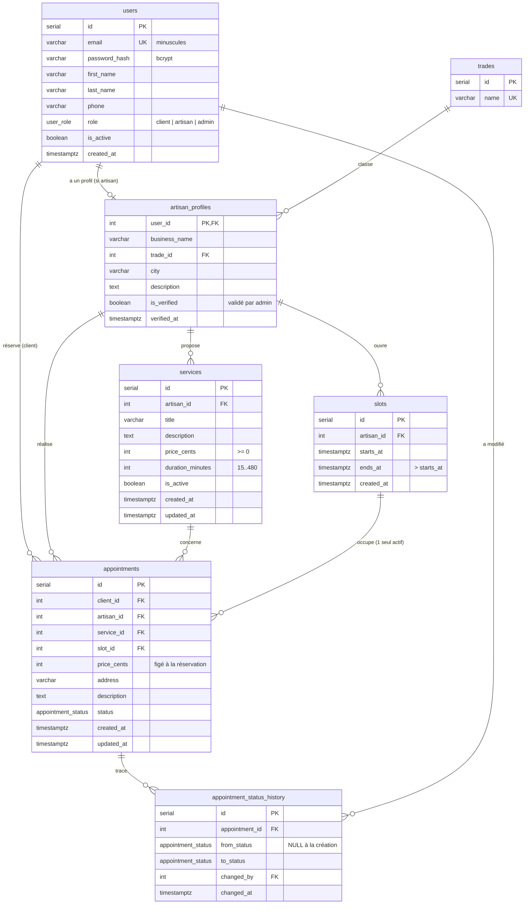

# CraftFlow — Modèle de données

Source de vérité : [`db/schema.sql`](../db/schema.sql) (PostgreSQL 16).

## Diagramme entité-relation



## Les 3 espaces et leurs tables

| Espace | Rôle | Tables lues / écrites |
|---|---|---|
| Client | `client` | lit `services`, `slots` ; écrit `appointments` (réserver, annuler) |
| Artisan | `artisan` | `artisan_profiles`, `services` (CRUD), `slots`, `appointments` (confirmer, terminer, annuler) |
| Administration | `admin` | `users` (suspendre), `artisan_profiles` (valider), statistiques ; annule un rendez-vous (modération) |

## Règles garanties par la base (et pas seulement par l'API)

| Règle métier | Mécanisme PostgreSQL |
|---|---|
| Pas de double réservation d'un créneau | Index unique partiel `appointments_one_active_per_slot` sur `slot_id` `WHERE status <> 'ANNULE'` |
| Un artisan n'a pas deux créneaux qui se chevauchent | Contrainte d'exclusion `slots_no_overlap` (GiST + `tstzrange`) |
| La prestation et le créneau d'un RDV appartiennent au même artisan | Clés étrangères composites `(service_id, artisan_id)` et `(slot_id, artisan_id)` |
| Le prix d'un RDV ne change pas si l'artisan modifie son tarif | Colonne `appointments.price_cents` copiée à la réservation |
| On ne perd pas l'historique en supprimant un client | `client_id ... ON DELETE RESTRICT` (+ désactivation via `is_active`) |
| Un artisan vérifié a toujours une date de vérification | `CHECK (is_verified = (verified_at IS NOT NULL))` |
| Emails uniques sans doublon de casse | `UNIQUE` + `CHECK (email = LOWER(email))` |
| Montants exacts | Entiers en centimes, jamais de `FLOAT` |
| `updated_at` toujours à jour | Trigger `set_updated_at()` |

## Types ENUM

Les colonnes `users.role` et `appointments.status` sont de type **ENUM**, ce qui limite les valeurs possibles à une liste fermée.

```sql
CREATE TYPE user_role AS ENUM ('client', 'artisan', 'admin');
CREATE TYPE appointment_status AS ENUM ('EN_ATTENTE', 'CONFIRME', 'TERMINE', 'ANNULE');

CREATE TABLE users (
  ...
  role user_role NOT NULL DEFAULT 'client'
);
```

Le projet utilise **PostgreSQL**, qui déclare l'ENUM comme un type à part entière (`CREATE TYPE`), puis l'utilise comme n'importe quel type de colonne. MySQL déclare l'ENUM directement dans la colonne : `role ENUM('client','artisan','admin')`. Le principe est le même, seule la syntaxe change.

Vérification : une valeur hors liste est refusée par la base, par exemple `role = 'pirate'` ou `status = 'FAIT'` renvoient une erreur `invalid input value for enum`.

Avantage par rapport à un `VARCHAR` avec un simple contrôle dans l'API : la règle reste vraie même si une autre application ou un script écrit directement dans la base.

## Machine à états des rendez-vous

```
            ┌──────────► ANNULE ◄──────────┐
            │                              │
   EN_ATTENTE ───────► CONFIRME ───────► TERMINE
```

Les transitions autorisées selon le rôle sont dans `src/services/statusMachine.js`. Chaque changement est enregistré dans `appointment_status_history` (qui, quand, de quel statut vers quel statut).

## Questions probables du jury

**« `appointments.artisan_id` est déductible de `service_id` : ce n'est pas de la redondance, contraire à la 3NF ? »**
C'est une dénormalisation volontaire et contrôlée. La colonne fait partie des deux clés étrangères composites : la base refuse toute valeur incohérente. Elle sert à garantir que prestation et créneau appartiennent au même artisan, et elle permet l'index `(artisan_id, status)` du tableau de bord artisan.

**« Et `appointments.price_cents` ? »**
Ce n'est pas une redondance : c'est une donnée historique différente (le prix *au moment de la réservation*), comme le prix sur une facture.

**« Pourquoi une seule table `users` pour 3 rôles ? »**
L'authentification est identique pour tous. Les données propres aux artisans sont dans `artisan_profiles` (relation 1-1), ce qui évite des colonnes vides pour les clients et les admins.

**« Pourquoi ne pas supprimer les prestations ? »**
Des rendez-vous passés y font référence. On les désactive (`is_active = false`) : elles disparaissent du catalogue mais l'historique reste intact.
